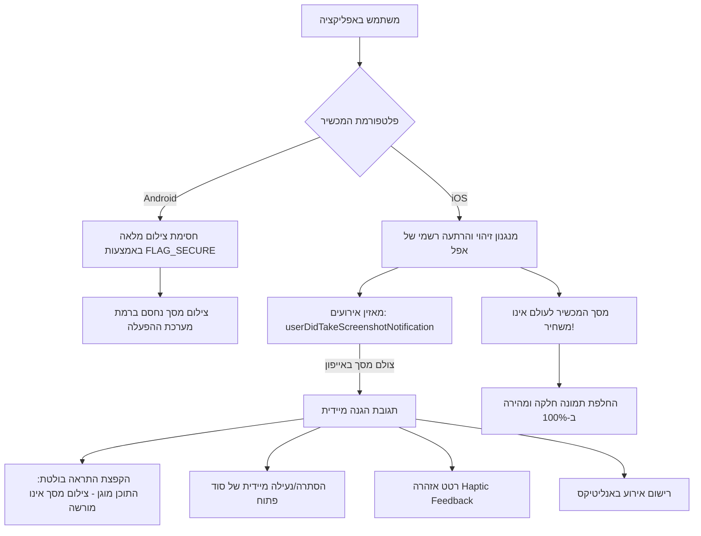

# תוכנית יישום מעודכנת: הגנת תוכן וצילומי מסך ב-iOS ואנדרואיד (אפשרות א')

## 1. רקע, ממצאים וניתוח הכשל

### א. תיאור הבעיה
* משתמשי אייפון רגילים שהחליפו תמונת פרופיל (בפרופיל, בהגדרות או בהרשמה) נתקלו במסך שחור ואטום לחלוטין מיד לאחר לחיצה על ה-**V** לאישור חיתוך התמונה.
* לאחר סגירה כפויה ופתיחה מחדש – התמונה עלתה תקינה (העלאת הקובץ ל-Storage ועדכון ה-Firestore עבדו ב-100%).
* משתמשי Admin וטסטרים עם הרשאת `canScreenshot: true` החליפו תמונה ללא כל בעיה.

### ב. שורש הכשל הטכנולוגי
1. **הבדל בין מערכות ההפעלה:**
   * **Android:** מכילה פקודת מערכת רשמית של גוגל (`FLAG_SECURE`) הפועלת ברמת החומרה, חוסמת צילומי מסך והקלטות מסך, ולעולם אינה משבשת את תצוגת האפליקציה או את המצלמה/גלריה.
   * **iOS:** אפל **אינה מספקת API לחסימת צילומי מסך**. כדי לחסום בכל זאת, ספריית `screen_protector` משתמשת בהאק פרטי של `UITextField` עם `isSecureTextEntry = true` על גבי ה-Window.
2. **ההתנגשות עם מנוע אפל:**
   * כאשר מופיע חלון מערכת של אפל (`UIImagePickerController` או חותך התמונות `TOCropViewController`), ונסגר – ה-WindowServer של אפל מאבד את הקישור ל-Flutter view ומרנדר את השכבה המאובטחת כמשטח שחור ואטום.
   * בגלל שכל 5 המסכים הראשיים יושבים ב-`IndexedStack` ב-`AppShell`, עדכון הפרופיל (`notifyListeners`) הריץ מחדש את `enableScreenProtectionForScreen` בכל המסכים ברקע בדיוק ברגע סגירת החלון הנייטיבי – מה שגרם לנעילה שחורה מוחלטת של המכשיר.

---

## 2. עקרונות הפתרון: מודל הגנה דיפרנציאלי (אפשרות א')

### היכן קיים תוכן מוגן באפליקציה?
הסודות והתוכן החסוי של Hushhh מוצגים במסכים הבאים:
1. **הפיד הראשי (`FeedScreen`):**
   * לשונית קרובים (Nearby)
   * לשונית במעקב (Following)
   * לשונית שמורים (Saved)
2. **מסך המפה (`MapScreen`):** כרטיסיות סודות שנפתחות על המפה.
3. **מסך הפרופיל (`ProfileScreen`):**
   * לשונית "ההאששים שלי"
   * לשונית "שמורים"
4. **מסך פרטי סוד בודד (`SecretDetailScreen`):** כרטיסיית הסוד המלאה.

---

## 3. שלבי הביצוע בקוד

### שלב 1: עדכון `AuthProvider` ([`lib/providers/auth_provider.dart`](file:///c:/Dev/hush-app/lib/providers/auth_provider.dart))
1. ביטול מוחלט של הקריאה ל-`ScreenProtector.preventScreenshotOn()` ב-iOS. מוודאים קריאה ל-`ScreenProtector.preventScreenshotOff()` כדי לוודא ששום שכבה ישנה לא יושבת על ה-Window.
2. שמירת `FLAG_SECURE` באנדרואיד פעיל ורציף דרך ערוץ הנייטיב (`enableScreenshotPrevention`).
3. הוספת `StreamController<void>` / זרם אירועי צילום מסך: `screenshotTakenStream`.
4. שיפור מאזין `ScreenProtector.addListener`:
   * זיהוי צילום מסך באייפון.
   * שידור האירוע לכל הרכיבים הפתוחים באפליקציה.
   * הקפצת SnackBar אדום בולט:
     * עברית: *"התוכן ב-Hushhh מוגן – צילום מסך אינו מורשה!"*
     * אנגלית: *"Content in Hushhh is protected – screenshots are not allowed"*
   * הפעלת רטט אזהרה (`HapticFeedback.heavyImpact()`).
   * רישום לאנליטיקס: `AnalyticsService().logScreenshotDetected()`.

### שלב 2: תגובה בזמן אמת בכרטיסיית הסוד ([`lib/widgets/secret_card.dart`](file:///c:/Dev/hush-app/lib/widgets/secret_card.dart))
1. האזנה ל-`screenshotTakenStream` מתוך `AuthProvider`.
2. אם המשתמש פתח סוד (`_revealed == true`) וצילם מסך:
   * הסוד ננעל מיד בחזרה (`_revealed = false`).
   * אם נוגן אודיו – הוא נעצר מיד.
   * כך המשתמש אינו יכול ללכוד שוב את הטקסט או להמשיך להאזין לאודיו שנחשף.

### שלב 3: ניקוי קריאות מיותרות במסכים
* ב-[`ProfileScreen`](file:///c:/Dev/hush-app/lib/screens/profile_screen.dart), [`SettingsScreen`](file:///c:/Dev/hush-app/lib/screens/settings_screen.dart), [`OnboardingScreen`](file:///c:/Dev/hush-app/lib/screens/onboarding_screen.dart), [`FeedScreen`](file:///c:/Dev/hush-app/lib/screens/feed_screen.dart), ו-[`MapScreen`](file:///c:/Dev/hush-app/lib/screens/map_screen.dart):
  * הפונקציות `enableScreenProtectionForScreen()` ו-`disableScreenProtectionForScreen()` ב-`AuthProvider` מנוטרלות מביצוע פעולות מסוכנות ב-iOS, כך שהן שומרות על תאימות קוד מלאה בלי לייצר תופעות לוואי.

### שלב 4: בדיקה, עדכון גרסה ודחיפה
1. הרצת `flutter analyze` לוודא 0 שגיאות.
2. עדכון גרסה ב-`pubspec.yaml` ל-`1.0.0+51`.
3. ביצוע Commit ו-Push ל-`origin main`.
