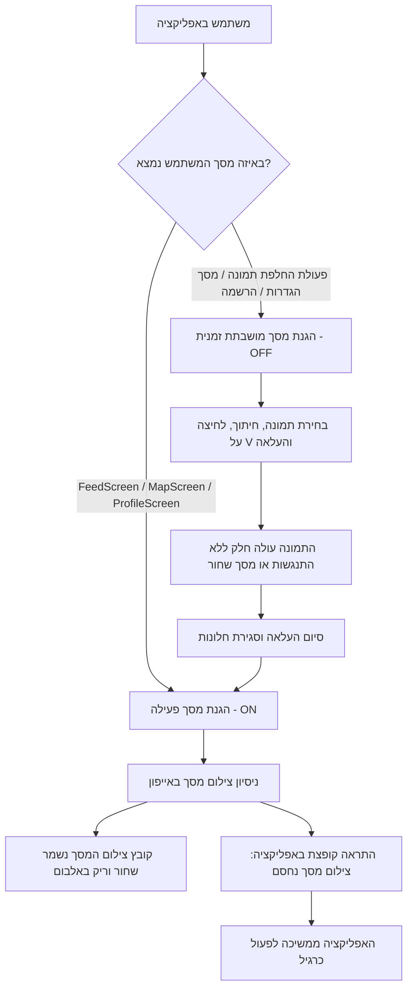

# תוכנית יישום: הגנת צילומי מסך ב-iOS ופתרון תקלות החלפת תמונה

## 1. רקע וניתוח התקלה

### א. תיאור הבעיה
* בעת החלפת תמונת פרופיל באייפון (במסך ההגדרות, במסך הפרופיל, ובתהליך ההרשמה), לאחר אישור חיתוך התמונה (לחיצה על V), מסך האפליקציה משחיר לחלוטין ולא מגיב, והמשתמש נאלץ לסגור את האפליקציה בכוח.
* לאחר פתיחה מחדש, התמונה החדשה מופיעה תקינה (כלומר השרת, פיירבייס, העלאת הקובץ ושמירת הנתונים – עבדו במלואם).
* טסטר שלו הוגדרה הרשאת `canScreenshot: true` (יקיר סבג) או משתמשי Admin החליפו תמונה ללא כל תקלה.

### ב. שורש התקלה
* מנגנון חסימת צילומי המסך ב-iOS של ספריית `screen_protector` מלביש שכבת `UITextField` מאובטחת על גבי ה-Window של האפליקציה.
* כאשר נפתח ונסגר מסך מערכת נייטיבי של אפל (`UIImagePickerController` או `TOCropViewController`), וההגנה מופעלת מחדש (`preventScreenshotOn`) מיד עם סגירת החלון הנייטיבי, מנוע הרינדור של אפל מאבד את שכבת ה-Flutter וצובע את כל המסך בשחור.

### ג. דרישת הליבה העסקית של Hushhh
* אסור לאפשר למשתמשי אייפון (בדיוק כמו באנדרואיד) לצלם מסך של סודות שנפתחו כדי להפיצם לחברים.
* חסימת צילומי המסך חייבת לחול על כל המקומות שבהם מוצגים סודות:
  1. מסך הפיד הראשי (`FeedScreen`)
  2. מסך המפה (`MapScreen`)
  3. **מסך הפרופיל (`ProfileScreen`) – שבו מוצגים "ההאששים שלי" והסודות השמורים!**
* מנגד, החלפת תמונת פרופיל (בהגדרות, בפרופיל ובהרשמה) חייבת לעבוד חלקה ללא שום השחרת מסך.

---

## 2. ארכיטקטורת הפתרון: הגנה מבוססת מסכים (Scoped Protection)

---

## 3. שלבי הביצוע המפורטים בקוד

### שלב 1: עדכון `AuthProvider` לניהול הגנה מבוסס מסכים (Scoped Protection)
* **קובץ יעד:** `lib/providers/auth_provider.dart`
* **מה בוצע:**
  1. משתנה מצב `_screenProtectionScopedDisabled = false`.
  2. מתודה `disableScreenProtectionForScreen()`: משביתה זמנית את ההגנה (`preventScreenshotOff`).
  3. מתודה `enableScreenProtectionForScreen()`: מחזירה את ההגנה לפעולה (`preventScreenshotOn`), עם בדיקה שלא מדובר ב-Admin או משתמש עם הרשאת צילום.
  4. באנדרואיד: השארת `FLAG_SECURE` קבוע ורציף דרך ערוץ הנייטיב (באנדרואיד המנגנון יציב ואינו מייצר תקלות).
  5. רישום מאזין `ScreenProtector.addListener` להקפצת SnackBar: "התוכן ב-Hushhh מוגן – צילום מסך אינו מורשה".

### שלב 2: ניקוי ה-Picker המשותף
* **קובץ יעד:** `lib/utils/profile_photo_picker.dart`
* **מה בוצע:** הסרת הקריאות הפנימיות להפעלה/השהיית הגנה מתוך ה-picker עצמו. הוא מתרכז אך ורק בבחירה וחיתוך.

### שלב 3: הגנת מסך הפרופיל (`ProfileScreen`)
* **קובץ יעד:** `lib/screens/profile_screen.dart`
* **מה בוצע:**
  1. ב-`didChangeDependencies`: מופעל `enableScreenProtectionForScreen()` — **כל עוד גוללים בפרופיל ורואים האששים ושמורים, המסך מוגן לחלוטין מצילום!**
  2. בפונקציה `_pickAndUploadPhoto`: ההגנה מושבתת רק לרגע בחירת התמונה והעלאתה, ומופעלת מחדש אוטומטית ברגע שההעלאה לשרת מסתיימת והחלונות הנייטיביים ירדו מהמסך.

### שלב 4: מסך ההגדרות וההרשמה
* **קבצי יעד:** `lib/screens/settings_screen.dart`, `lib/screens/onboarding_screen.dart`
* **מה בוצע:** השבתת הגנה בעת שהייה במסכים שבהם אין סודות ומחליפים תמונה, והפעלה מחדש בעת חזרה לפיד.

### שלב 5: מסכי הפיד והמפה
* **קבצי יעד:** `lib/screens/feed_screen.dart`, `lib/screens/map_screen.dart`
* **מה בוצע:** וידוא שההגנה פועלת ב-100% ומגינה על כל הסודות.

---

## 4. תרחישי בדיקה ואימות לאחר הבנייה

| # | תרחיש בדיקה | תוצאה מצופה |
|---|---|---|
| 1 | צילום מסך ב-ProfileScreen (בלשונית "ההאששים שלי" או "שמורים") | קובץ צילום המסך בגלריה שחור/אטום; מופיעה התראה באפליקציה; האפליקציה לא קופאת |
| 2 | החלפת תמונה במסך הפרופיל באייפון | התמונה נבחרת, נחתכת, עולה בהצלחה, המסך בהיר ותקין לחלוטין ללא מסך שחור |
| 3 | החלפת תמונה במסך ההגדרות באייפון | התמונה מתעדכנת מיד, המסך בהיר ותקין |
| 4 | תהליך הרשמה של משתמש חדש ובחירת תמונה | התמונה נבחרת ונחתכת בהצלחה, ההרשמה מסתיימת חלק |
| 5 | צילום מסך בפיד (בסוד פתוח) או במפה באייפון | קובץ צילום המסך בגלריה שחור/אטום; התראה צפה מופיעה; האפליקציה ממשיכה לעבוד כרגיל |
| 6 | בדיקה באנדרואיד | `FLAG_SECURE` חוסם צילומי מסך כרגיל; החלפת תמונה עובדת כרגיל |
