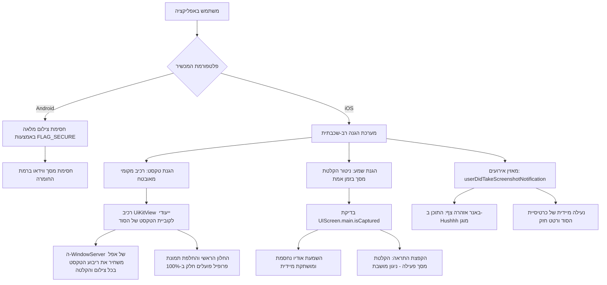

# תוכנית יישום מעודכנת: הגנת תוכן הרמטית ב-iOS ואנדרואיד (השחרת טקסט מקומית וחסימת הקלטת שמע)

## 1. רקע, ממצאים ודרישות אבטחה

### א. תיאור האתגר ב-iOS
* **באנדרואיד:** מערכת ההפעלה מספקת חסימה ברמת החומרה (`FLAG_SECURE`), שחוסמת צילום מסך והקלטת וידאו לכלל האפליקציה באופן מוחלט, ללא הפרעה לחלונות נייטיביים.
* **ב-iOS:** 
  1. צילום מסך רגיל: הודעת המערכת של אפל מגיעה בדיעבד (שבריר שניה לאחר לכידת הפיקסלים). לכן נעילה מאוחרת בתוכנה אינה מונעת את שמירת התמונה.
  2. השחרה גלובלית בעבר (דרך `UIWindow` כולו) גרמה לניתוק מנוע הרינדור של Flutter מול חלונות מערכת (כמו `UIImagePickerController` וחיתוך תמונה), והשחירה את האפליקציה כולה.
  3. **הקלטת מסך (Screen Recording):** מאפשרת למשתמשים ללכוד סרטון של המסך יחד עם השמע של האשש קולי, מה שעלול להרוס את המשחקיות של Hushhh.

### ב. עקרונות הפתרון ההרמטי
1. **השחרת טקסט מקומית (Local Secure View):**
   * שימוש בשכבה מאובטחת נייטיבית (`isSecureTextEntry = true`) אך ורק על **ריבוע הטקסט של הסוד הגלוי** (`UiKitView`).
   * שאר האפליקציה, החלון הראשי, מסך הפרופיל, המצלמה והגלריה נשארים 100% רגילים ולעולם אינם מושפעים.
   * בצילום מסך או בהקלטת וידאו – מנוע ה-WindowServer של אפל משחיר ומעלים את ריבוע הטקסט ישירות ברמת החומרה עוד לפני יצירת קובץ התמונה.
2. **חסימת האשש קולי בזמן הקלטת מסך:**
   * האזנה בזמן אמת ל-`UIScreen.main.isCaptured` (ה-API הרשמי של אפל להקלטת מסך).
   * אם הקלטת מסך פועלת – ניגון האודיו נעצר מיד ולא ניתן להפעיל Play.
   * הסרטון המוקלט יוצא אילם ומושחר.
3. **מעטפת אזהרה והרתעה:**
   * התראה מיידית, רטט אזהרה, נעילה כפולה של הסוד ורישום לאנליטיקס.

---

## 2. ארכיטקטורת המערכת

---

## 3. פירוט יישום הרכיבים

### א. צד ה-Native ב-iOS (`ios/Runner/AppDelegate.swift`)
* רישום `HushSecureTextViewFactory` שמייצר `HushSecureTextView` (`FlutterPlatformView`).
* הרכיב מייצר קונטיינר מקומי מאובטח באמצעות `UITextField` עם `isSecureTextEntry = true`.
* מציג `UILabel` עם הטקסט של הסוד, תוך תמיכה מלאה ב-RTL (עברית), גודל גופן מותאם וצבע לבן.
* הרכיב מופעל אך ורק עבור תיבת הטקסט של הסוד הפתוח.

### ב. ווידג'ט מאובטח ב-Flutter (`lib/widgets/secure_secret_text.dart`)
* ב-Android / פלטפורמות אחרות: מציג `Text` רגיל (כי אנדרואיד מוגן ע"י `FLAG_SECURE`).
* ב-iOS: מציג `UiKitView` מסוג `hush_secure_text_view` עם חישוב מידות מדויק באמצעות `TextPainter`.
* **בידוד שכבות מול התפריט וחלונות (Drawer / Modal Isolation):** כדי למנוע את חדירת השכבה הנייטיבית (`UiKitView`) דרך שכבת הקנבס של ה-Drawer או מודאלים בעת פתיחתם, הרכיב מאזין ל-`UIProvider.isDrawerOpen` ול-`ModalRoute.isCurrent`. בזמן שהתפריט פתוח, הוא מציג שטח חלופי מדויק (`SizedBox` במידות זהות), ומחזיר את הרכיב הנייטיבי ברגע סגירת התפריט – מה שמעניק תפריט אטום ונקי ב-100% ללא כל שקיפות.

### ג. שילוב בכרטיסיית הסוד (`lib/widgets/secret_card.dart`)
* החלפת ה-`Text` הסטטי של הסוד הגלוי ב-`SecureSecretText`.
* שילוב בדיקת הקלטת מסך פעילה בעת לחיצה על כפתור ניגון האודיו (`_togglePlay`).
* האזנה לזרם הקלטת מסך: עצירת הנגן בזמן אמת אם החלה הקלטת מסך ברקע.

### ד. ספק האימות וההגנה (`lib/providers/auth_provider.dart`)
* האזנה ל-`ScreenProtector.addListener` עבור:
  1. צילום מסך (`onScreenshot`): שידור ב-`screenshotTakenStream`, רטט, הקפצת באנר ונעילת סוד.
  2. הקלטת מסך (`onScreenRecord`): שידור ב-`screenRecordingStream` ועצירת ניגון אודיו בכל האפליקציה.

---

## 4. בדיקות, אימות והפצה
1. וידוא `flutter analyze` עם 0 שגיאות.
2. עדכון גרסה ב-`pubspec.yaml` ל-`1.0.0+53`.
3. ביצוע Git Commit ודחיפה ל-`origin main`.
